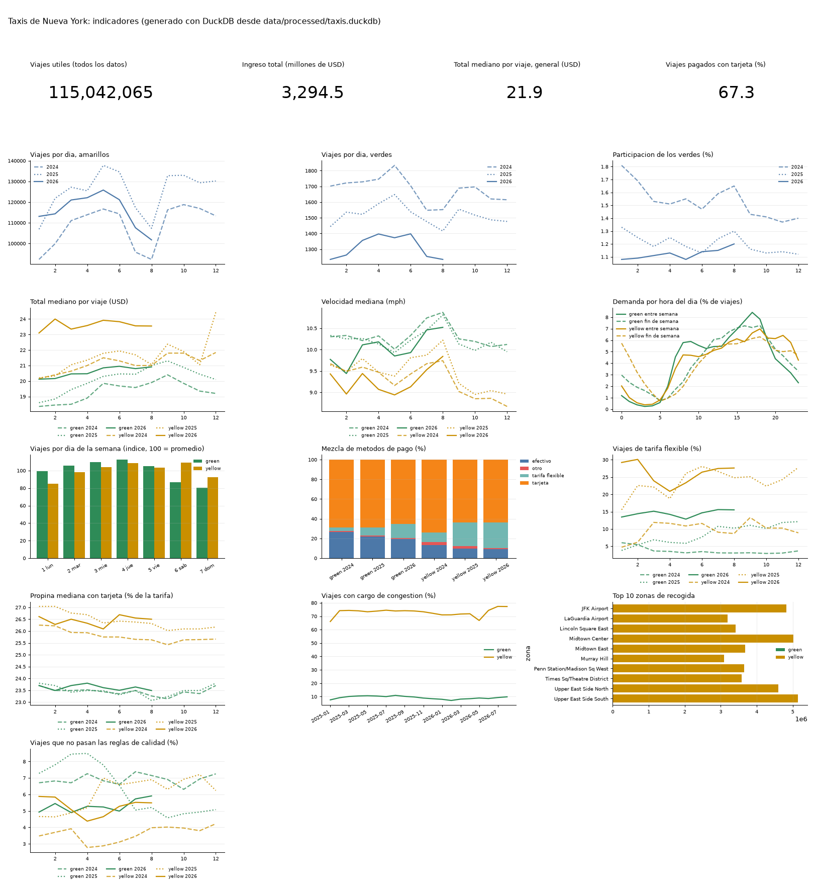

# Ejercicio 7: indicadores y tablero

## Cómo está armado

El tablero vive en Metabase, la herramienta que trae el repositorio, y toma sus datos de DuckDB: Metabase se conecta al archivo `data/processed/taxis.duckdb`, la tabla materializada que construimos en el ejercicio 6, usando la ruta de dentro del contenedor (`/workspace/data/processed/taxis.duckdb`) y en modo de solo lectura, que es lo que pide la nota del README del docente porque un `.duckdb` solo admite un proceso con permiso de escritura. Cada indicador es una pregunta de Metabase con SQL nativo, y el SQL de cada una está en un archivo de `sql/ejercicio_07/`, de modo que la consulta existe en un solo lugar y el script que monta el tablero la lee desde ahí.

Como Metabase no puede crear objetos en una base de solo lectura, las vistas que usan los indicadores se crean antes con `scripts/preparar_vistas_tablero.py` (`sql/ejercicio_07/00_vistas_tablero.sql`). La vista `viajes_anio` deja los viajes cuya fecha cae dentro del año de su archivo y agrega año, mes, hora y día de la semana, y `viajes_limpios` le suma las reglas de limpieza que definimos en el ejercicio 3 (duración entre 1 minuto y 6 horas, distancia mayor a 0 y hasta 100 millas, total mayor a 0). Los indicadores de pagos usan `viajes_anio` y no la vista limpia, por la misma razón que en el ejercicio 4: los totales negativos y la tarifa flexible son justamente lo que queremos medir. Esto deja 68,763,199 viajes útiles de los 71,870,407 de la tabla, o sea que las reglas descartan un 4.3%.

Armar el tablero a mano con clics no es reproducible, así que `scripts/montar_tablero_metabase.py` lo hace por la API de Metabase: completa la configuración inicial, registra la base DuckDB, crea las 17 preguntas y las acomoda en el tablero, y se puede volver a ejecutar sin duplicar nada. Los pasos y las credenciales locales están en el README. Comprobamos que las 17 preguntas se ejecutan dentro de Metabase contra DuckDB sin errores, con tiempos de entre 0.2 y 10.9 segundos cada una, donde las más lentas son las que calculan medianas sobre toda la tabla. Además, `scripts/generar_indicadores.py` dibuja las mismas gráficas con matplotlib a partir de las mismas consultas y las guarda en `docs/img/tablero/`, que usamos como evidencia y para revisar los indicadores sin abrir Metabase.

## 7.1 Preguntas de análisis

Partimos de lo que nos dejaron pensando los ejercicios anteriores: dos servicios de escala muy distinta, una categoría de viajes de tarifa flexible que crece, un cargo de congestión nuevo, y datos de dos años que ahora se pueden comparar. De ahí salieron doce preguntas, más cuatro cifras generales.

| N.º | Pregunta |
|---|---|
| 1 | ¿Cómo evoluciona el volumen diario de viajes y cómo se comparan los mismos meses entre años? |
| 2 | ¿Cuánto pesan los taxis verdes frente al total y cambia esa proporción? |
| 3 | ¿A qué horas se concentra la demanda y es distinta entre semana y fin de semana? |
| 4 | ¿Qué días de la semana tienen más viajes y se comportan igual amarillos y verdes? |
| 5 | ¿Cuánto paga un pasajero por un viaje típico y cómo cambia con el tiempo? |
| 6 | ¿Cómo pagan los pasajeros y cambia esa mezcla entre años? |
| 7 | ¿Qué tan importante es la tarifa flexible y crece con el tiempo? |
| 8 | ¿Qué tan frecuente es el cargo de congestión del centro de Manhattan? |
| 9 | ¿De qué zonas sale la mayoría de los viajes? |
| 10 | ¿Cambia con el tiempo la velocidad a la que se mueve el tráfico? |
| 11 | ¿Cuánto dejan de propina los pasajeros que pagan con tarjeta? |
| 12 | ¿Mejora o empeora la calidad de los datos con el tiempo? |
| 13 a 16 | ¿Cuántos viajes, cuánto ingreso, cuál es el total típico y qué porcentaje paga con tarjeta, en todos los datos? |

## 7.2, 7.3, 7.6 y 7.7 Indicadores, consultas y justificación

La siguiente tabla relaciona cada indicador con su consulta, la pregunta que responde y la gráfica que usamos, y debajo explicamos por qué elegimos cada uno.

| Indicador | Consulta | Pregunta | Gráfica |
|---|---|---|---|
| Viajes por día, amarillos y verdes | `7_01a_viajes_por_dia_amarillos.sql`, `7_01b_viajes_por_dia_verdes.sql` | 1 | Líneas, una serie por año |
| Participación de los verdes (%) | `7_02_participacion_verdes.sql` | 2 | Líneas, una serie por año |
| Demanda por hora del día | `7_03_demanda_por_hora.sql` | 3 | Líneas, cuatro series |
| Viajes por día de la semana (índice) | `7_04_viajes_por_dia_de_semana.sql` | 4 | Barras agrupadas |
| Total mediano por viaje | `7_05_total_mediano_por_mes.sql` | 5 | Líneas por tipo y año |
| Mezcla de métodos de pago | `7_06_metodos_de_pago.sql` | 6 | Barras apiladas al 100% |
| Viajes de tarifa flexible (%) | `7_07_tarifa_flexible_por_mes.sql` | 7 | Líneas por tipo y año |
| Viajes con cargo de congestión (%) | `7_08_cargo_congestion_por_mes.sql` | 8 | Líneas por tipo |
| Top 10 zonas de recogida | `7_09_top_zonas_origen.sql` | 9 | Barras horizontales apiladas |
| Velocidad mediana | `7_10_velocidad_mediana_por_mes.sql` | 10 | Líneas por tipo y año |
| Propina mediana con tarjeta | `7_11_propina_con_tarjeta.sql` | 11 | Líneas por tipo y año |
| Viajes que no pasan las reglas de calidad (%) | `7_12_calidad_viajes_descartados.sql` | 12 | Líneas por tipo y año |
| Viajes útiles, ingreso total, total mediano, pago con tarjeta | `7_13a` a `7_13d` | 13 a 16 | Número |

Para el volumen elegimos viajes por día y no totales mensuales, porque los meses no tienen los mismos días, y dibujamos amarillos y verdes en gráficas separadas porque comparten una escala imposible (unos 110 mil viajes por día contra unos 1,300), de modo que juntos los verdes serían una línea pegada al eje. La participación de los verdes la sumamos para tener a la vista justamente esa proporción. Para el ritmo de la demanda usamos el porcentaje de viajes de cada hora dentro de su tipo, y el día de la semana lo expresamos como un índice con base 100 en el promedio de la semana, por la misma razón de escala.

Para el dinero escogimos la mediana del total por viaje y no el promedio, porque en el ejercicio 4 vimos que el 8% de los viajes amarillos genera una cuarta parte del ingreso y arrastra el promedio hacia arriba. La mezcla de métodos de pago la dibujamos como barras al 100%, porque lo que importa es cómo se reparte, y la tarifa flexible la separamos como indicador propio porque en el análisis exploratorio resultó ser la categoría que más pesa y que más cambia. El cargo de congestión se limita a los meses donde la columna existe, y la propina se mide solo con tarjeta, porque las propinas en efectivo no se registran. La velocidad mediana es un indicador indirecto del estado del tráfico, y el porcentaje de viajes descartados nos dice si las reglas de calidad que calibramos con 2026 siguen siendo razonables en otros años, que es algo que vimos que no se podía dar por hecho.

## 7.4 y 7.5 Visualizaciones y tablero

El tablero se llama "Taxis de Nueva York: indicadores" y organiza las 17 preguntas en seis filas: las cuatro cifras generales arriba, los viajes por día de amarillos y verdes a continuación, después participación de los verdes, total mediano y velocidad, luego la demanda por hora y por día de la semana, la fila de pagos (mezcla, tarifa flexible y propina), y abajo el cargo de congestión, las zonas y la calidad. Esa disposición va de lo general a lo específico, y deja juntos los indicadores que se leen mejor en conjunto, como el total mediano y la tarifa flexible. Para abrirlo hay que entrar a <http://127.0.0.1:3000> con las credenciales del README y buscar el tablero en la colección "Lab 8 DuckDB". La captura del tablero tal como se ve en Metabase se guarda en `docs/img/tablero/metabase_tablero.png`, junto a las gráficas generadas con matplotlib.

## 7.8 Interpretación y hallazgos

Esta interpretación la escribimos cuando la tabla tenía 2024 y 2026, y las cifras que aparecen aquí corresponden a ese momento. Al incorporar 2025 en el ejercicio 8 el tablero pasó a mostrar tres años y encontramos que algunas de estas lecturas eran incompletas, así que las corregimos abajo y el análisis completo con los tres años está en `docs/ejercicio_08.md`.

Las cifras generales son 68,763,199 viajes útiles, 2,004.3 millones de dólares de ingreso, un total mediano de 22.08 dólares por viaje y un 69.7% de viajes pagados con tarjeta, aunque hay que leerlas sabiendo que mezclan los doce meses de 2024 con los ocho de 2026, por lo que no sirven para comparar años y las usamos solo como orden de magnitud.

El hallazgo que más nos llamó la atención es el de los pagos. La tarifa flexible pasó de 9.9% de los viajes amarillos en 2024 a 26.0% en 2026, y en verdes de 3.7% a 14.5%, y en la mezcla de métodos se ve que fue a costa de los otros: en amarillos la tarjeta bajó de 74.0% a 63.8% y el efectivo de 13.5% a 9.1%. El indicador mensual lo muestra con más detalle, porque en 2024 la tarifa flexible parte en 4.7% en enero y llega a 13.3% en septiembre, y en 2026 está entre 20.9% y 30.1% todos los meses, lo que con solo dos años nos pareció un cambio de golpe, pero con 2025 vimos que en realidad fue gradual a lo largo de 2025 y después se estabilizó (ver `docs/ejercicio_08.md`). Esto cambia el significado de otros indicadores, porque estos viajes no registran pasajeros ni propina, y por eso nos parece correcto que la propina mediana, que solo mira tarjeta, se mantenga estable: entre 25.4% y 26.7% de la tarifa en amarillos y alrededor de 23.5% en verdes, en los dos años.

El segundo hallazgo es que los viajes son más caros. El total mediano de los amarillos en enero pasó de 20.16 a 23.10 dólares entre 2024 y 2026 (un 14.6% más) y en agosto de 21.00 a 23.55 (12.1% más), y en verdes de 18.36 a 20.12 en enero y de 19.90 a 20.91 en agosto. En los ocho meses comparables 2026 está por encima de 2024 sin excepción. Una parte puede venir de recargos como el de congestión, que según el indicador alcanza a entre 67% y 77% de los viajes amarillos y a entre 7% y 10% de los verdes, pero eso es solo una hipótesis, porque el cargo es de 0.75 dólares y la diferencia en la mediana de los amarillos es de entre 2.4 y 3.6 dólares, por lo que creemos que hay otras causas, como cambios de tarifa, que no podemos identificar con estos datos. Con 2025 vimos que en los amarillos el salto no es un cambio gradual sino un escalón en diciembre de 2025, y que viene de la tarifa del taxímetro y no de los recargos (ver `docs/ejercicio_08.md`).

El tercer hallazgo va en dirección contraria para los verdes. Su participación cae de entre 1.4% y 1.8% de los viajes en 2024 a entre 1.1% y 1.2% en 2026, y sus viajes diarios pasan de 1,702 a 1,235 en enero (27% menos) y de 1,552 a 1,235 en agosto (20% menos), mientras que los amarillos suben de 92,303 a 113,093 en enero (22% más) y de 92,282 a 101,731 en agosto (10% más), aunque con 2025 vimos que esa subida escondía un máximo en 2025, porque en 2026 los amarillos bajan entre 3% y 10% respecto a 2025. Cada servicio se mueve en dirección distinta, y en los amarillos se repite la caída de julio y agosto en los dos años, con un mínimo de 92 mil viajes por día en agosto de 2024 y de 102 mil en agosto de 2026, antes de recuperarse en septiembre en 2024.

Entre los patrones más estables está el ritmo del día. Entre semana, los verdes tienen su pico a las 17 h (8.4% de sus viajes) y los amarillos a las 18 h (7.1%), pero los amarillos conservan un segundo pico a las 21 h (6.4%) y tienen actividad nocturna fuerte en fin de semana, con 5.6% de sus viajes a medianoche, mientras que los verdes no. Por día, el índice muestra el contraste que ya habíamos visto: los amarillos tienen el sábado como día más fuerte (108 contra un promedio de 100) y el lunes como el más débil (84), mientras que los verdes tienen el jueves en lo más alto (113) y el domingo en lo más bajo (80).

Otros dos indicadores nos dejaron preguntas abiertas. La velocidad mediana es menor en 2026 que en 2024 en los ocho meses comparables de los verdes y en siete de los ocho de los amarillos (por ejemplo 8.96 contra 9.49 mph en febrero), lo cual nos llama la atención porque el cargo de congestión de la zona del centro de Manhattan empezó en enero de 2025 con la idea de aliviar el tráfico, y con 2025 vimos que en los amarillos la velocidad sí mejoró ese año (de 9.52 a 9.70 mph de enero a agosto) y volvió a bajar en 2026, de modo que no empeoró de forma continua. Y el porcentaje de viajes que no pasan las reglas de calidad subió en amarillos de entre 2.8% y 4.2% en 2024 a entre 4.4% y 5.9% en 2026, mientras que en verdes bajó de entre 6.3% y 7.4% a entre 4.9% y 5.9%, es decir que la calidad de los datos no mejora ni empeora de forma pareja y reafirma que conviene medirla por año.

En cuanto a las zonas, las diez con más viajes están dominadas por amarillos, y los aeropuertos pesan mucho, con JFK en 2.96 millones de viajes de recogida y LaGuardia en 1.97 millones. La zona de las diez donde más verdes hay es Upper East Side North, con 6,231 viajes, aunque esa cifra sigue siendo una fracción pequeña de los 2.8 millones de amarillos en la misma zona.

## Qué cambió con 2025

Todos los indicadores leen todos los años que haya en la tabla y no tienen ninguno escrito a mano, así que para pasar a tres años en el ejercicio 8 bastó completar la tabla con `scripts/benchmark_parquet_vs_tabla.py`, que inserta solo los meses nuevos, y ejecutar otra vez los scripts de montaje y de gráficas. Las gráficas de `docs/img/tablero/` ya muestran los tres años. Con la tabla de 3.4 GB las preguntas de Metabase se volvieron más lentas, hasta 25.7 segundos la más pesada, y al subir la memoria de DuckDB dentro de Metabase de 1 a 3 GB bajaron a un máximo de 15.3 segundos, algo que conectamos con lo que medimos en el ejercicio 6 y explicamos en `docs/ejercicio_08.md`.
